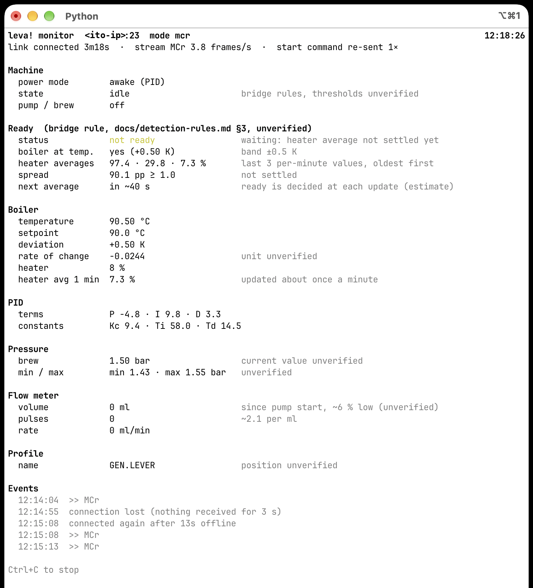

# Live monitor

[`tools/monitor.py`](../tools/monitor.py) connects to the ito module like the capture
tool, decodes the stream with the bridge's own parsers and shows every field known so far
once per second. Nothing is written to disk and nothing is sent to MQTT. Use it to check
the machine and the sensors at a glance, to watch a heat-up next to a capture, and as a
cross-check for the bridge's live values and its *ready* decision.



*Warm start, about 3 min after power-on: the boiler is within the band, but the last three
per-minute heater averages (97.4, 29.8, 7.3 %) are still far apart, so the bridge does
not report ready yet. No scale was connected, so there is no "Scale" section.*

## Requirements

- Python 3.8 or newer, standard library only.
- The `leva2mqtt/` package next to `tools/` – the monitor uses `leva2mqtt/frame.py`,
  `display.py` and `machine.py`, so it always shows exactly what the bridge decodes.
  Run it from a full checkout of the repository. With a sparse checkout, include both
  folders: `git sparse-checkout set tools leva2mqtt`. Without the package the script
  stops with a message saying so.
- The serial menu must be allowed on the machine (*Setup → Wifi → Permissions → Serial
  menu*), see [protocol.md](protocol.md).

## Usage

```sh
python3 tools/monitor.py <ito-ip>                 # screen view, redrawn every second
python3 tools/monitor.py <ito-ip> --lines         # one line per second, for scrolling or a file
python3 tools/monitor.py <ito-ip> --raw           # also show the raw MCr frame
python3 tools/monitor.py <ito-ip> --no-resend     # only watch, e.g. while the Leva Companion app is open
```

Stop with Ctrl+C.

| Option | Default | Effect |
|---|---|---|
| `--mode mcr\|display\|none` | `mcr` | Start command sent on every connect: `MCr` (sensor frames), `MC@` (display frames) or nothing |
| `--interval N` | 1 | Seconds between updates |
| `--lines` | off | One compact line per update instead of the redrawn screen. Used automatically when the output is not a terminal |
| `--raw` | off | Also show the last raw `MCr` frame with character positions, to look for fields that are not decoded yet |
| `--no-keepalive` | off | Do not send the keepalive newline every 5 s |
| `--no-resend` | off | Do not re-send the start command when no frames of the wanted kind arrive |
| `--wake` | off | Send `MCcREPORT SP1` once after the first connect: wakes the machine from standby / eco, **it beeps** |
| `--port N` | 23 | TCP port, e.g. 2300 for [`tools/fake_ito.py`](../tools/fake_ito.py) |
| `--no-color` | off | No colours (also off when `NO_COLOR` is set) |

## What it sends

Only these, and nothing that changes a setting:

- the start command of `--mode` after every connect (`MCr` by default),
- a bare newline every 5 s as keepalive,
- the start command again while no frame of the wanted kind has arrived for 5 s. This
  ends the heartbeat-only state after a power-on and undoes another client switching the
  module to display frames (the report mode is global for the module),
- `MCcREPORT SP1` once, only with `--wake`.

Without `--wake` the monitor never wakes the machine: connecting, the keepalive and
`MCr` do not wake it (see [protocol.md](protocol.md)).

It reconnects every 2 s while the module is unreachable and drops a connection on which
nothing at all has arrived for 3 s, because the module does not close the connection
when it loses power. Each reconnect shows up under *Events*.

## The screen

Sections appear only when they have something to show. A sensor the frame does not
deliver (`?` in the frame, e.g. no scale, or the machine in standby) is left out, so in
standby only *Machine* and *Ready* remain. Grey notes next to a value carry the status from
[protocol.md](protocol.md): *unverified* means not yet confirmed by a capture.

| Section | Content |
|---|---|
| header | Module address, start mode, clock |
| link line | Connected for how long, what is arriving (`MCr` with frames per second, display frames, heartbeat only, nothing) and how often the start command was re-sent. Shown in yellow when the stream is not the one asked for |
| Machine | Power mode (awake / eco / standby), the bridge's state (`heating`, `idle`, `ready`, `brewing`, `hot water`, `steam`, …) and the pump: running time while `*` is set, otherwise the last run. The `MCr` frame has no shot timer; the monitor times the `*` flag itself |
| Ready | The bridge's ready decision step by step, see below |
| Boiler | Temperature, setpoint (eco setpoint in eco), deviation, rate of change (unit unverified), heater output and the per-minute average |
| PID | Terms P, I, D and constants Kc, Ti, Td |
| Pressure | Brew pressure, min / max of the interval (both unverified as to their exact meaning), target of the active profile while a profile runs |
| Flow meter | Volume since the pump started, pulses, rate in ml/min |
| Scale | Weight and flow by weight |
| Profile | Active profile name |
| Display (MC@) | Only while display frames arrive (`--mode display`, or another client switched the mode): decoded screen code and the display text. The last alert seen stays listed |
| Raw MCr frame | With `--raw` |
| Events | The last connects, disconnects and commands sent |

### Ready

The bridge decides "ready" like the firmware's ready beep
([detection-rules.md](detection-rules.md), section 3; two hits, **unverified** as a
general rule):

- at each update of the per-minute heater average (frame positions 73–77, every ~60 s),
- the boiler is within ±0.5 K of the setpoint (*boiler at temp.*),
- and the last three per-minute averages lie within less than 1.0 percentage point
  (*spread*).

The section shows each of these values, the reason while it is not ready
(*waiting: …*), the estimated time to the next update, and – once ready – since when.
After a shot or hot water, ready is kept for 120 s even if the boiler is low
(*recovery*, `bridge.ready_grace`). The firmware's own `READY` text is listed when it was
seen in display frames.

After starting the monitor (or after a reconnect) three updates are needed before ready
can be reported, i.e. about 2–3 min even on a long warm machine – the same as the bridge.

Replaying the cold-start capture `heatup-cold2` through the monitor marks ready at
10:36:35, the update right before the ready beep.

## Line mode

`--lines` prints one line per update. Missing sensors are left out here too; while the
stream is not the one asked for, the status is shown in brackets. Example from the cold
start capture around the ready beep:

```
10:34:50  awake/idle  T 90.25 SP 90.0 H 10% avg 10.4% p 1.65bar vol 0ml 0ml/min  avgs 22.4/16.0/10.4 spread 12.0
10:35:50  awake/idle  T 90.05 SP 90.0 H 11% avg 10.7% p 1.40bar vol 0ml 0ml/min  avgs 16.0/10.4/10.7 spread 5.6
10:36:36  awake/ready  T 90.15 SP 90.0 H 8% avg 10.1% p 1.30bar vol 0ml 0ml/min  READY
```

Events (connect, commands, lost connection) appear as lines with `#`. To keep a log:
`python3 tools/monitor.py <ito-ip> --lines > monitor.log`.

## Without the machine

Serve a capture with the fake module and point the monitor at it:

```sh
python3 tools/fake_ito.py captures/<capture>.txt --port 2300 &
python3 tools/monitor.py 127.0.0.1 --port 2300 --no-resend
```

The fake replays the file with its original timing (`--speed` to run faster; the ready
decision then no longer sees one-minute steps). It does not react to commands.

## Troubleshooting

| What you see | Meaning |
|---|---|
| `heartbeat only ($id: leva!)` | The module is up, but the `MCr` came too early after power-on. The monitor re-sends it every 5 s; frames normally follow within seconds |
| `display frames instead of MCr (another client sent MC@?)` | Another client (e.g. the Leva Companion app) switched the global report mode. The monitor switches back after 5 s, which disturbs that app – use `--no-resend` while it is open |
| `nothing received` / `connection lost (nothing received for 3 s)` | Machine switched off or unreachable; the monitor reconnects on its own |
| `No module named 'leva2mqtt'` | `tools/` without the package next to it, see *Requirements* |
| Ready stays at *not ready* although the machine beeped | Please note the time and keep a capture (`tools/capture.py … --mode mcr`, type `# ready beep`) – the rule rests on two captures so far |
